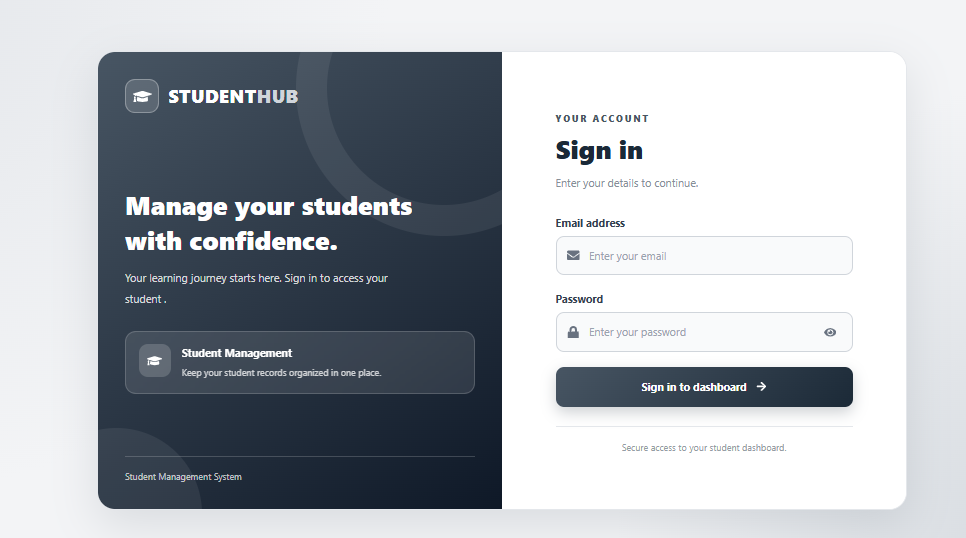
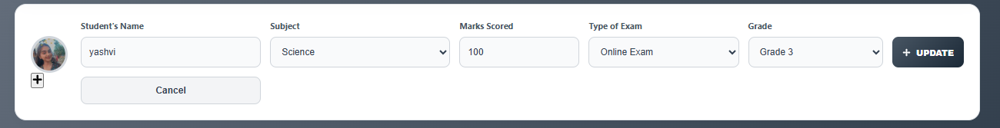
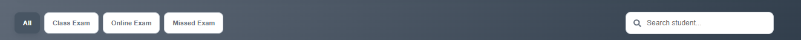
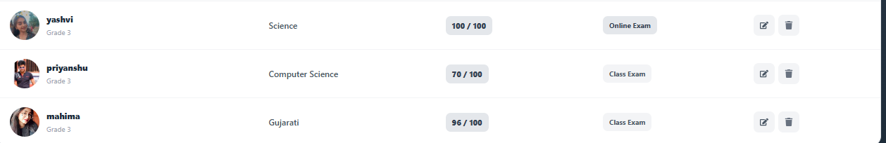

# Student Management System

A student management web application built with **React**, **Plain Redux**, **React-Redux**, **React Router DOM**, **Axios**, **Bootstrap**, **React Icons**, and **JSON Server**.

> This project uses Plain Redux and React-Redux. It does **not** use Redux Toolkit or Redux Thunk.

## Screenshots

Place your actual screenshots in the `src/assets/screen-shots/` folder using the filenames below.

### Login Page




### Dashboard


### Update Student



### Searching Student



### Sorting Student



---

## Features

### Authentication

- Login using email and password.
- Validate login credentials using the `users` collection in JSON Server.
- Store login information in local storage.
- Protect the dashboard route.
- Navigate to the dashboard after successful login.
- Logout functionality.
- No registration page.

### Student Management

- Fetch and display student records.
- Add new students.
- Edit existing students.
- Update student information.
- Delete students.
- Search students by name or subject.
- Filter students by exam type.
- Sort student records.
- Display student name, subject, marks, exam type, grade, and image.
- Use a default image when a student does not have a custom image.

### Form Validation

- Validate required fields.
- Validate student name.
- Validate subject.
- Validate marks.
- Validate exam type.
- Validate grade.
- Display validation messages when required fields are missing or invalid.

### Interface

- Bootstrap-based responsive layout.
- React Icons for buttons and interface elements.
- Student dashboard with summary information.
- Student list with search and filter functionality.
- Add and update student forms.
- Responsive design for different screen sizes.

---

## Tech Stack

| Technology | Purpose |
|---|---|
| React | User interface |
| Vite | Development server and build tool |
| Redux | Central application state |
| React-Redux | Connect React components with Redux |
| React Router DOM | Routing and protected routes |
| Axios | HTTP requests |
| JSON Server | Local REST API and data storage |
| Bootstrap | Styling and responsive layout |
| React Icons | Interface icons |
| JavaScript | Application logic |
| HTML | Page structure |
| CSS | Custom styling |

---

## Folder Structure

```text
student-management-system/
│
├── public/
│
├── src/
│   │
│   ├── assets/
│   │   ├── yash.jpg
│   │   ├── diya.jpg
│   │   ├── dev.jpg
│   │   ├── dhruv.jpg
│   │   ├── anaya.jpg
│   │   ├── krish.jpg
│   │   │
│   │   └── screen-shots/
│   │       ├── login.png
│   │       ├── validation.png
│   │       ├── dashboard.png
│   │       ├── form.png
│   │       ├── list.png
│   │       ├── update.png
│   │       ├── searching.png
│   │       └── sorting.png
│   │
│   ├── components/
│   │   │
│   │   ├── authentication/
│   │   │   ├── Login.jsx
│   │   │   ├── ProtectedRoute.jsx
│   │   │   └── validation.js
│   │   │
│   │   └── students/
│   │       ├── Dashboard.jsx
│   │       ├── StudentForm.jsx
│   │       ├── StudentList.jsx
│   │       ├── StudentDetails.jsx
│   │       ├── StudentSearch.jsx
│   │       └── studentService.js
│   │
│   ├── redux/
│   │   │
│   │   ├── action/
│   │   │   ├── authActions.js
│   │   │   └── studentActions.js
│   │   │
│   │   ├── reducer/
│   │   │   ├── authReducer.js
│   │   │   └── studentReducer.js
│   │   │
│   │   └── store/
│   │       └── store.js
│   │
│   ├── App.jsx
│   ├── App.css
│   └── main.jsx
│
├── db.json
├── index.html
├── package.json
└── README.md
```

---

## Complete Application Workflow

### 1. Run the Backend API

- JSON Server reads the `db.json` file.
- The `users` collection stores login accounts.
- The `students` collection stores student records.
- API base URL is:

```text
http://localhost:3000
```

---

### 2. Login Workflow

1. The user opens the Login page.
2. The user enters an email and password.
3. `Login.jsx` sends a request to JSON Server using Axios.
4. The application gets the users from the `users` collection.
5. Entered credentials are compared with the stored credentials.
6. If the credentials are correct, `loginSuccess` is dispatched to Redux.
7. Login information is stored in local storage.
8. The user is redirected to `/dashboard`.
9. If credentials are incorrect, a validation/error message is displayed.

---

### 3. Protected Route Workflow

1. The user tries to open `/dashboard`.
2. `ProtectedRoute.jsx` checks the authentication state.
3. If the user is logged in, the dashboard is displayed.
4. If the user is not logged in, the user is redirected to `/login`.

---

### 4. Load Students

1. `Dashboard.jsx` loads student records.
2. `studentService.js` sends an Axios GET request.
3. The request is sent to:

```text
GET http://localhost:3000/students
```

4. The received student data is dispatched to Redux.
5. `studentReducer.js` updates the Redux state.
6. The student list is displayed on the dashboard.

---

### 5. Add Student

1. The user opens the student form.
2. The user enters student information.
3. Form validation checks the required fields.
4. A student object is created.
5. Axios sends a POST request to JSON Server.
6. The new student is added to the `students` collection.
7. Redux is updated with the new student.
8. The new student appears in the student list.

Example:

```text
POST http://localhost:3000/students
```

---

### 6. Edit and Update Student

1. The user clicks the **Edit** button.
2. The selected student's information is loaded into the form.
3. The user changes the required information.
4. Form validation is performed.
5. Axios sends a PUT request.
6. The student record is updated in JSON Server.
7. Redux state is updated.
8. The updated student is displayed in the list.

Example:

```text
PUT http://localhost:3000/students/:id
```

---

### 7. Search Student

The student list provides search functionality.

The user can search by:

- Student name
- Subject

Example:

```text
Search: Aarav
```

The list displays matching student records.

---

### 8. Filter Student

Students can be filtered according to their exam type.

Example exam types:

- Online Exam
- Offline Exam

The user can select an exam type and view only the matching students.

---

### 9. Sort Student

The student list supports sorting.

Students can be sorted according to the available sorting options, such as:

- Name
- Marks
- Grade

Sorting makes it easier to find and manage student records.

---

### 10. Delete Student

1. The user clicks the **Delete** button.
2. The selected student's ID is used.
3. Axios sends a DELETE request.
4. JSON Server removes the student.
5. Redux updates the student list.
6. The deleted student is removed from the dashboard.

Example:

```text
DELETE http://localhost:3000/students/:id
```

---

### 11. Logout

1. The user clicks the **Logout** button.
2. Login information is removed from local storage.
3. Redux authentication state is updated.
4. The user is redirected to the login page.
5. The protected dashboard cannot be accessed without logging in again.

---

## Data Structure

The `db.json` file contains two main collections:

- `users`
- `students`

Example:

```json
{
  "users": [
    {
      "id": "1",
      "name": "Yasin Mithani",
      "email": "yasin@gmail.com",
      "password": "yasin123"
    }
  ],
  "students": [
    {
      "id": "1",
      "name": "Aarav Patel",
      "subject": "English Literature",
      "marks": 70,
      "examType": "Online Exam",
      "grade": "Grade 3",
      "image": ""
    }
  ]
}
```

> This is an example data structure. Keep your actual records in `db.json`.

---

## Setup and Run

### Requirements

- Node.js
- npm
- React
- Vite

### 1. Install Packages

Open the project folder in the terminal and run:

```bash
npm install
```

If required packages are not already installed:

```bash
npm install axios bootstrap react-icons react-redux redux react-router-dom
```

Install JSON Server:

```bash
npm install -D json-server
```

---

## 2. Start JSON Server

Open a terminal in the project root where `db.json` is located.

Run:

```bash
npx json-server --watch db.json --port 3000
```

JSON Server will run at:

```text
http://localhost:3000
```

### API Endpoints

Users:

```text
http://localhost:3000/users
```

Students:

```text
http://localhost:3000/students
```

**Keep this terminal running.**

---

## 3. Start React Frontend

Open a **second terminal** in the same project folder.

Run:

```bash
npm run dev
```

Vite will provide a local URL, usually:

```text
http://localhost:5173
```

Open the URL in your browser.

> Both JSON Server and the React development server must be running at the same time.

---

## Demo Login

If these accounts are present in your `db.json`, you can use:

| Email | Password |
|---|---|
| `admin@gmail.com` | `admin123` |
| `yasin@gmail.com` | `yasin123` |

> These are development/demo credentials only. Do not use real passwords or sensitive information in a public repository.

---

## Redux Data Flow

```text
React Component
       |
       | dispatch(action)
       v
Redux Action
       |
       v
Reducer
       |
       v
Redux Store
       |
       v
React Component
       |
       v
UI Re-renders
```

For API operations, the React component calls the Axios service first and then dispatches the returned data through Redux.

This project uses **Plain Redux** and **React-Redux**.

It does **not** use:

- Redux Toolkit
- Redux Thunk

---

## API Endpoints

| Method | Endpoint | Purpose |
|---|---|---|
| GET | `/users` | Read users for login validation |
| GET | `/students` | Fetch student records |
| POST | `/students` | Add a student |
| PUT | `/students/:id` | Update a student |
| DELETE | `/students/:id` | Delete a student |

### Base URL

```text
http://localhost:3000
```

---

## Important Notes

- JSON Server is used as a local development API.
- JSON Server is not a production authentication server.
- Do not publish real passwords or sensitive student information.
- Images stored in `src/assets` are bundled with the React application.
- Keep image files small for better performance.
- Make sure the API URL matches the JSON Server port.
- Keep JSON Server running while using the application.
- Keep the screenshot filenames and paths consistent with the actual project.
- If `localhost:3000` is not running, Axios requests will show `ERR_CONNECTION_REFUSED`.

---

## Common Error

If you see:

```text
Failed to load resource: net::ERR_CONNECTION_REFUSED
```

or:

```text
AxiosError: Network Error
```

check that JSON Server is running:

```bash
npx json-server --watch db.json --port 3000
```

Then test:

```text
http://localhost:3000/users
```

If the users data appears in the browser, the API is running correctly.

---

## Future Improvements

- Add pagination.
- Add better loading messages.
- Add success and error notifications.
- Add stronger authentication.
- Add server-side authentication.
- Improve dashboard statistics.
- Deploy the React frontend.
- Deploy the backend API.
- Add more advanced student filtering and sorting.

---

